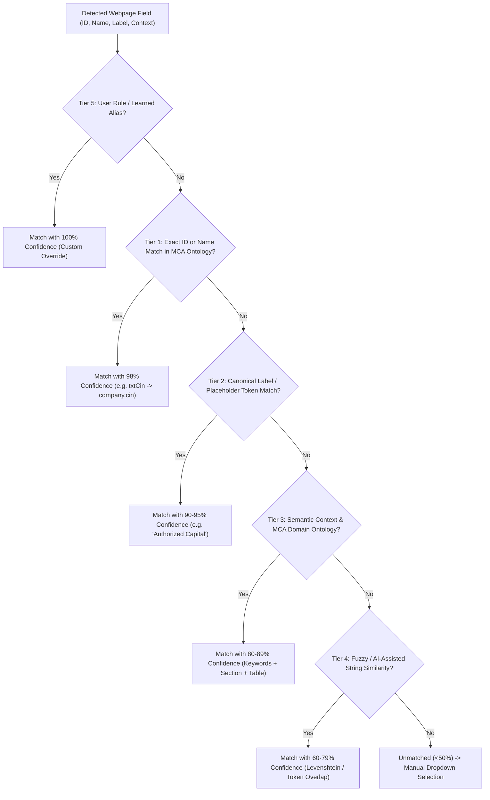

# Germin8 – MCA Portal V3 Research & Engine Architecture

## 1. MCA V3 Portal In-Depth Research

The Ministry of Corporate Affairs (MCA) transitioned from its legacy V2 portal (which was heavily dependent on offline Adobe Acrobat PDF form wrappers with embedded XFA scripts) to **MCA V3 (mca.gov.in)**, an enterprise-grade web-first Single Page Application (SPA).

### Architectural Key Characteristics:
1. **Dynamic JSON Form Engines & Controlled Inputs**:
   - Modern enterprise frontends (React / Angular / customized Liferay form wrappers) manage form inputs through internal reactive state loops.
   - Simply setting DOM properties directly (e.g., `element.value = "..."`) does **not** fire component change detection handlers, leaving the underlying state `dirty: false` and dropping entered values upon page navigation or validation.
   - **Germin8 Solution**: We utilize `Object.getOwnPropertyDescriptor(HTMLInputElement.prototype, 'value').set` to invoke the native value setter directly on the element prototype, followed by bubbling synthetic events (`input`, `change`, and `blur`).

2. **Conditional Field Rendering & Wizards**:
   - High volumes of conditional toggles: for example, toggling between "Private Company" and "Public Company" instantly mounts/unmounts statutory disclosure blocks.
   - Multi-step wizards (e.g., SPICe+ Part A, Part B, AGILE-PRO-S, INC-9) swap DOM subtrees dynamically.
   - **Germin8 Solution**: The Universal DOM Scanner incorporates a high-performance `MutationObserver` that listens for child list additions without polling, alerting the extension when new fieldsets mount.

3. **Repeatable Sections (Directors, Shareholders, Charges)**:
   - Forms such as DIR-12, SPICe+, and MGT-7 feature dynamic tables where directors or subscribers are added via `Add Row` buttons.
   - **Germin8 Solution**: The scanner calculates 0-based row and column coordinates, headers from `<thead>`, and maps them to array indices in the client database (e.g., `directors[0].din`, `directors[1].din`, `shareholders[0].shares`).

4. **Strict Format Validations**:
   - MCA V3 enforces strict client-side regex rules:
     - **CIN**: `^[LU]{1}[0-9]{5}[A-Z]{2}[0-9]{4}[A-Z]{3}[0-9]{6}$` or LLPIN `^[A-Z]{3}-[0-9]{4}$`
     - **DIN**: Exactly 8 digits `^[0-9]{8}$`
     - **PAN**: `^[A-Z]{5}[0-9]{4}[A-Z]{1}$`
     - **PIN Code**: Exactly 6 digits `^[1-9]{1}[0-9]{5}$`
   - **Germin8 Solution**: The built-in Post-Fill Validation Engine cross-checks filled DOM values against both database values and statutory regex specifications.

5. **Government Safety Protocol**:
   - Filings require DSC (Digital Signature Certificate) tokens via local emSigner bridges and payment gateways.
   - **Germin8 Solution**: Hard safety barrier — the engine **never** auto-submits a government form, mandating human-in-the-loop review and sign-off.

---

## 2. 5-Tier Intelligent Matching Hierarchy

---

## 3. Supported MCA Forms in Profiles Engine

| Form Code | Form Title | Typical Fields | Key Entities Filled |
|---|---|---|---|
| **SPICe+** | Integrated Company Incorporation | ~45 fields | Company details, Capital, Registered office, Directors table, Subscribers |
| **DIR-12** | Appointment of Directors / KMP | ~28 fields | DIN, Name, Father's Name, DOB, Gender, Designation, Date of Appointment, PAN, Mobile, Email |
| **AOC-4** | Filing of Financial Statements | ~52 fields | Balance Sheet, Turnover, Net Profit, Net Worth, Auditor Name, FRN, CSR |
| **MGT-7** | Annual Return of Company | ~40 fields | Shareholding, Indebtedness, Director particulars, AGM date, Meetings |
| **INC-22** | Situation of Registered Office | ~18 fields | Full address lines, State, City, District, PIN code, Police Station |
